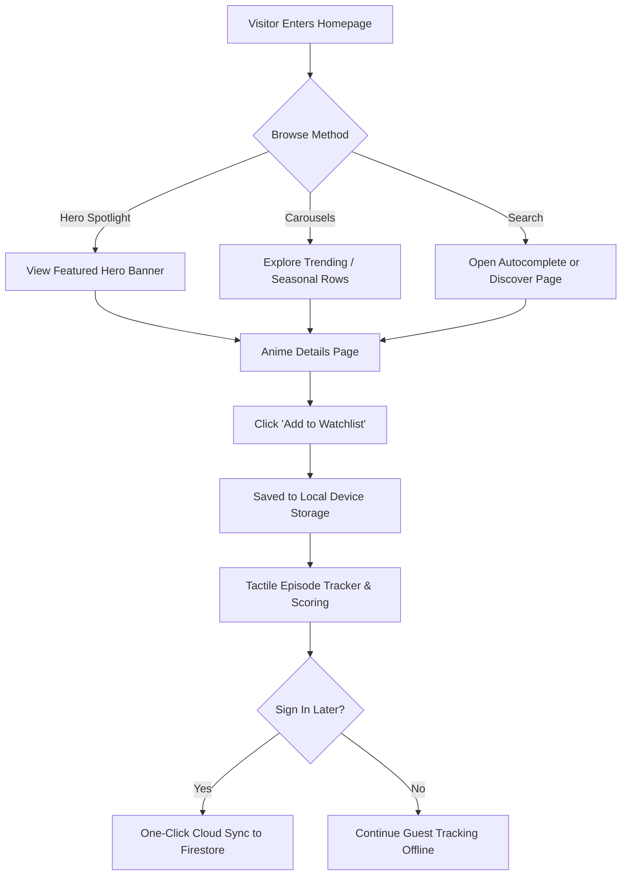
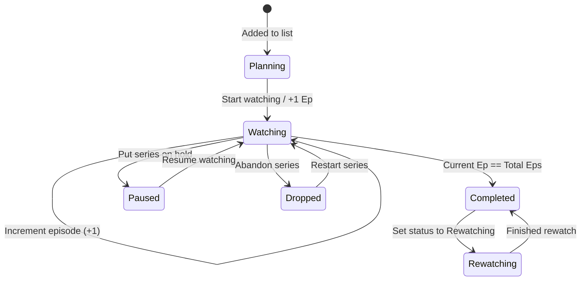
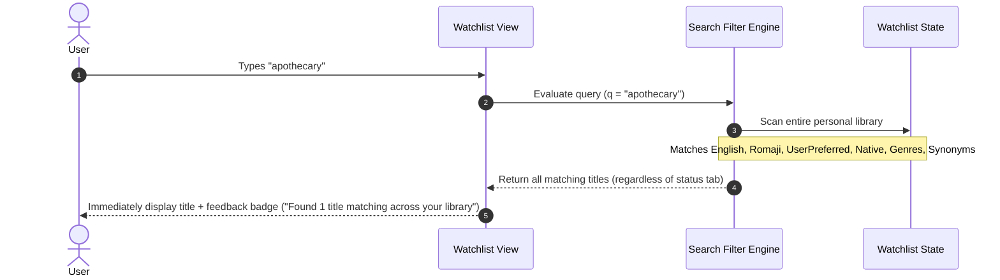

# 🎨 App Flow & UI/UX Design Brief — AnimeSenpai

**Platform:** AnimeSenpai Anime Universe  
**Target:** Mobile Web (320px–480px), Tablet (640px–1024px), Desktop (1024px–2560px+)  
**Design System:** 3-Color Luxury Minimalist (**Obsidian · Platinum · Luminous Indigo**)  

---

## 1. Core User Flows & State Machines

### 1.1 Guest Discovery & Tracking Flow
Allows visitors to immediately browse 20,000+ anime titles and maintain a personal watchlist offline without requiring account creation.



### 1.2 Watchlist Episode Tracking & Status Flow
Enables fast, 1-tap episode progression with automatic status transitions upon completion.



### 1.3 Universal Real-Time Search & Ingestion Flow
Demonstrates how typing in the watchlist instantly resolves titles across all statuses and language representations.



---

## 2. Navigation Architecture & Screen Hierarchy

```mermaid
graph TD
    Root[Home Page '/']
    Root --> Discover[Catalog Discover '/discover']
    Root --> Watchlist[My Watchlist '/watchlist']
    Root --> Details[Anime Details '/anime/:id']
    Root --> Settings[Settings Workspace '/settings']
    Root --> Auth[Authentication '/login' | '/signup']
    
    Discover --> Filters[Genre / Season / Format / Status Drawers]
    Discover --> Details
    
    Watchlist --> StatusMenu[Mobile Status Options / Desktop Tabs]
    Watchlist --> ImportExport[JSON Backup & Restore Modal]
    Watchlist --> Details
    
    Settings --> Profile[Photo Picker / Live Camera / Username]
    Settings --> Display[Text Size / Title Language / Density]
    Settings --> Security[Email Verification / Password / Account Deletion]
```

---

## 3. UI/UX Design System Specification

### 3.1 3-Color Hierarchy Specification

```
┌────────────────────────────────────────────────────────┐
│  Obsidian (#000000 / #0c0c0f) — 60% Dominance          │
│  Canvas, backgrounds, cards, navigation glass shells    │
├────────────────────────────────────────────────────────┤
│  Platinum (#f5f5f7 / #9a9aa6) — 30% Structural         │
│  Headlines, body copy, borders, muted metadata         │
├────────────────────────────────────────────────────────┤
│  Luminous Indigo (#5360e6 / #7582ff) — 10% Accent      │
│  Primary CTA buttons, active tabs, progress, brand dot │
└────────────────────────────────────────────────────────┘
```

* **Obsidian Foundations:**
  - Background Base: `#000000` (Pure OLED Black)
  - Card Surfaces: `#0c0c0f` / `#121217`
  - Border Frames: `#23232b` / `#2e2e38`
* **Platinum Typography:**
  - Primary Headlines: `#f5f5f7` (High-contrast, zero eye fatigue)
  - Secondary Metadata: `#9a9aa6` (WCAG AA compliant contrast > 4.5:1)
  - Subtle Labels: `#666672`
* **Luminous Indigo Accent:**
  - Primary Buttons: `#5360e6` (Hover: `#4552d4`, Active: `#3844bd`)
  - Accent Text & Glows: `#7582ff`
  - Focus Rings: `#5360e6` with 2px offset

### 3.2 Mobile-First Ergonomic Principles
1. **Thumb Reachability:** Essential primary controls (episode steppers, status dropdowns, navigation triggers) are positioned in the bottom 60% of the viewport.
2. **Minimum Touch Target:** All interactive buttons, icon toggles, and list items maintain a minimum touch target size of **40×40px** (recommended **44×44px**).
3. **Zero Horizontal Spill:** All containers enforce `min-w-0` and `overflow-x-hidden`. Table views convert seamlessly to vertical card stacks on viewports `< 640px`.
4. **Uncluttered Canvas:** Floating accessory pills (`Buy me a coffee`, `Share`) sit compactly at `bottom: 10px` with dedicated clearance (`pb-28` to `pb-32`) to prevent content obstruction.

---

## 4. Micro-Interactions & Animation Tokens

| Interaction | Trigger | Animation Token / Style | Purpose |
| :--- | :--- | :--- | :--- |
| **Notice Chevron** | Toggle click | `rotate-180 transition-transform duration-300` | Flips upside-down to signal open state |
| **Notice Dismiss** | Cross (`X`) click | `active:scale-90 opacity-0 transition-all` | Cleanly unmounts notice from view |
| **Button Tap** | Mouse / Touch down | `active:scale-95 transition-transform duration-150` | Tactile native application response |
| **Episode Stepper** | Tap `+1` button | `active:scale-90 bg-white/20 transition-all` | Immediate sensory progress feedback |
| **Filter Switch** | Status change | `transition-opacity duration-300 animate-fadeIn` | Eliminates abrupt layout jumps |
| **Shimmer Skeletons** | Content loading | `animate-pulse bg-gradient-to-r` | Prevents cumulative layout shifts |
