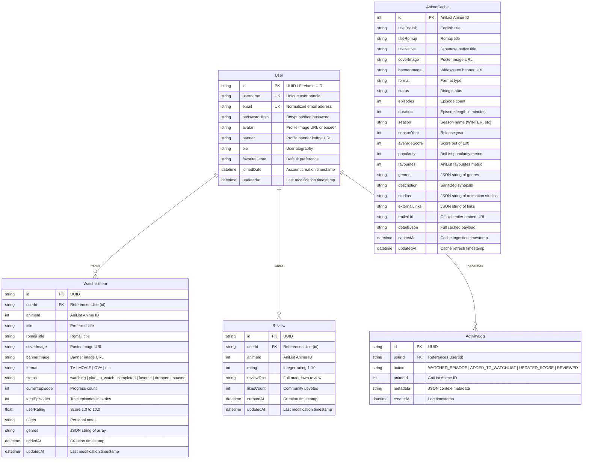

# 🗄️ Backend Schema & API Architecture — AnimeSenpai

**Architecture:** Hybrid Dual-Persistence (Prisma ORM Database + Cloud Firestore Realtime Store)  
**ORM:** Prisma Client v6  
**Security Model:** Defense-in-Depth, Strict Owner-Only Access, Zero Raw SQL  

---

## 1. Entity-Relationship Data Model



---

## 2. Cloud Firestore Real-Time NoSQL Schema

In addition to the relational backend database, user profiles and cross-device sync leverage Google Cloud Firestore with owner-only declarative rules (`firestore.rules`).

### 2.1 Collection: `users`
* **Path:** `/users/{userId}`
* **Document ID:** `{userId}` (Must match Firebase Auth `request.auth.uid`).
* **Field Specifications:**

| Field | Type | Rules & Constraints | Description |
| :--- | :--- | :--- | :--- |
| `id` | `string` | Required on create; immutable; must equal `userId` and `request.auth.uid` | Unique user identifier |
| `username` | `string` | Required; 3–24 characters; regex `^[a-zA-Z0-9._-]+( [a-zA-Z0-9._-]+)*$` | User display handle |
| `usernameLower` | `string` | Optional; 3–24 characters; must equal `username.lower()` | Lowercase handle for indexing |
| `email` | `string` | Required; <= 254 characters; RFC-compliant email regex | User email address (PII) |
| `avatar` | `string` | Required; URL <= 2048 chars or base64 data URI <= 150,000 chars | Profile picture |
| `banner` | `string` | Optional; URL <= 500 characters | Optional profile banner image |
| `joinedDate` | `string` | Optional; 0–64 characters; immutable once created | Account creation date string |
| `animeWatchedCount` | `int` | Optional; range `0` to `100,000` | Completed anime count |
| `episodesWatchedCount` | `int` | Optional; range `0` to `10,000,000` | Total episodes watched |
| `daysWatched` | `number` | Optional; range `0` to `100,000` | Days spent watching anime |
| `favoriteGenre` | `string` | Optional; 0–64 characters; regex `^[a-zA-Z0-9 /&-]{0,64}$` | Primary favorite genre |

---

## 3. REST API Contract & Route Architecture

All endpoints are hosted at `https://anime-watch-recommendation.onrender.com/api`.

### 3.1 Authentication Routes (`/api/auth`)
* `POST /api/auth/register`
  - Body: `{ username, email, password }`
  - Rate Limit: `5 req / 15 min`
  - Returns: `{ user, token }`
* `POST /api/auth/login`
  - Body: `{ email, password }`
  - Rate Limit: `10 req / 15 min`
  - Returns: `{ user, token }`
* `GET /api/auth/me`
  - Headers: `Authorization: Bearer <token>`
  - Returns: `{ user }`
* `PUT /api/auth/profile`
  - Headers: `Authorization: Bearer <token>`
  - Body: `{ avatar?, banner?, bio?, favoriteGenre? }`
  - Returns: `{ user }`

### 3.2 Watchlist Routes (`/api/watchlist`)
* `GET /api/watchlist`
  - Headers: `Authorization: Bearer <token>`
  - Returns: `WatchlistItem[]`
* `POST /api/watchlist`
  - Headers: `Authorization: Bearer <token>`
  - Body: `{ animeId, title, romajiTitle?, coverImage?, status, totalEpisodes?, currentEpisode?, userRating? }`
  - Returns: `{ item }`
* `PUT /api/watchlist/:id`
  - Headers: `Authorization: Bearer <token>`
  - Body: `{ status?, currentEpisode?, userRating?, notes? }`
  - Returns: `{ item }`
* `DELETE /api/watchlist/:id`
  - Headers: `Authorization: Bearer <token>`
  - Returns: `{ success: true, message: "Item removed" }`

### 3.3 Recommendation & Anime Routes (`/api/recommendations` & `/api/anime`)
* `GET /api/recommendations/personalized`
  - Headers: `Authorization: Bearer <token>`
  - Returns: `AnimeCardData[]` (Calculated based on user's top genres, ratings, and completion history)
* `GET /api/anime/:id`
  - Returns: Cached full anime metadata or proxies to upstream AniList GraphQL API

---

## 4. Upstream AniList GraphQL v2 Ingestion Contract

```graphql
query GetAnimeDetails($id: Int!) {
  Media(id: $id, type: ANIME) {
    id
    title {
      romaji
      english
      native
      userPreferred
    }
    coverImage {
      extraLarge
      large
      medium
      color
    }
    bannerImage
    format
    status
    episodes
    duration
    season
    seasonYear
    averageScore
    meanScore
    popularity
    favourites
    genres
    synonyms
    description(asHtml: false)
    nextAiringEpisode {
      episode
      airingAt
      timeUntilAiring
    }
    trailer {
      id
      site
      thumbnail
    }
    studios(isMain: true) {
      nodes {
        id
        name
        siteUrl
      }
    }
    characters(sort: ROLE, perPage: 12) {
      edges {
        role
        node {
          id
          name {
            full
            native
          }
          image {
            large
            medium
          }
        }
        voiceActors(language: JAPANESE) {
          id
          name {
            full
            native
          }
          image {
            large
            medium
          }
        }
      }
    }
    relations {
      edges {
        relationType
        node {
          id
          title {
            userPreferred
          }
          coverImage {
            large
          }
          format
        }
      }
    }
  }
}
```

---

## 5. Security & Data Integrity Controls

1. **Parameterization:** All database operations strictly use Prisma ORM query builders (`prisma.watchlistItem.findMany`, `prisma.user.create`). Zero dynamic SQL execution.
2. **Security Middleware:** Pre-flight sanitization cleans request bodies against null byte attacks, prototype pollution, and HTTP Parameter Pollution (HPP).
3. **Cascading Deletion:** When a `User` account is deleted via Firebase Auth or backend API, cascading constraints (`onDelete: Cascade`) guarantee that all corresponding `WatchlistItem`, `Review`, and `ActivityLog` records are permanently removed from disk.
