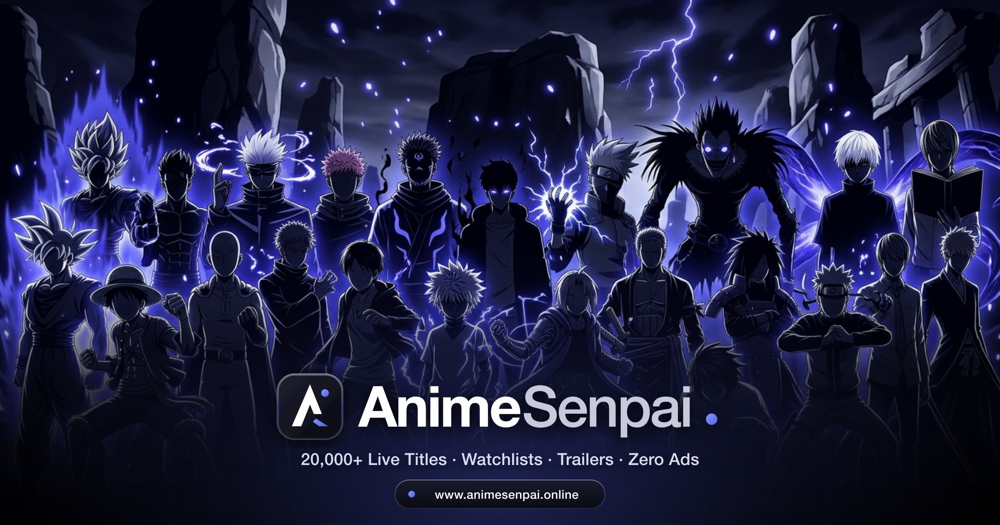

# ⚡ AnimeSenpai — Full-Stack Anime Discovery & Watchlist Platform

<p align="center">
  
</p>

<p align="center">
  <strong>An independent, modern anime discovery catalog and personal watchlist tracker powered by the live AniList GraphQL API.</strong>
</p>

<p align="center">
  <a href="https://www.animesenpai.online" target="_blank">
    
  </a>
  <a href="https://vercel.com" target="_blank">
    
  </a>
  <a href="https://render.com" target="_blank">
    
  </a>
  <a href="SECURITY.md">
    
  </a>
</p>

<p align="center">
  <a href="TRD.md"></a>
  <a href="APP_FLOW.md"></a>
  <a href="BACKEND_SCHEMA.md"></a>
  <a href="architecture.md"></a>
  <a href="design.md"></a>
  <a href="SECURITY.md"></a>
  <a href="CODE_OF_CONDUCT.md"></a>
  <a href="LICENSE"></a>
</p>

---

## 📚 Documentation & Governance

* 🏛️ **[Technical Requirements Document (TRD.md)](TRD.md)** — Comprehensive engineering specification, SLAs, Core Web Vitals, API contracts, and security architecture.
* 🎨 **[App Flow & UI/UX Design Brief (APP_FLOW.md)](APP_FLOW.md)** — Complete user flow diagrams, screen hierarchy, 3-color palette tokens, and tactile micro-interactions.
* 🗄️ **[Backend Schema & API Architecture (BACKEND_SCHEMA.md)](BACKEND_SCHEMA.md)** — Entity-relationship models, Prisma ORM schema, Firestore declarative security rules, and REST endpoint specs.
* 🏛️ **[Architecture Guide (architecture.md)](architecture.md)** — Edge topology, AniList GraphQL pipelines, Pub/Sub event bus, and caching strategy.
* 🎨 **[Design System (design.md)](design.md)** — Monochrome Obsidian/Platinum tokens, Luminous Indigo button accent, responsive container queries, and accessibility specs.
* 🛡️ **[Security Policy (SECURITY.md)](SECURITY.md)** — Responsible vulnerability disclosure, Firestore rules, CSP, CAPTCHA, rate limiting, and SQLi protection.
* 🤝 **[Contributing (CONTRIBUTING.md)](CONTRIBUTING.md)** & **[Code of Conduct (CODE_OF_CONDUCT.md)](CODE_OF_CONDUCT.md)** — Guidelines for pull requests and community standards.
* ⚖️ **[License (LICENSE)](LICENSE)** — Open-source MIT License.

---

## 🌐 Live Production Deployments

* 🌐 **Production Web Application:** [https://www.animesenpai.online](https://www.animesenpai.online)
* ⚙️ **Production Backend API:** [https://anime-watch-recommendation.onrender.com/api](https://anime-watch-recommendation.onrender.com/api)
* 🩺 **Backend Health & Ping:** [https://anime-watch-recommendation.onrender.com/ping](https://anime-watch-recommendation.onrender.com/ping)

---

## ✨ Features at a Glance

* **🎨 3-Color Luxury UI (Obsidian · Platinum · Luminous Indigo):** Pure `#000000` / `#0c0c0f` surfaces and `#f5f5f7` / `#9a9aa6` typography across the interface, reserving `#5360e6` Luminous Indigo strictly for primary CTA buttons and active controls.
* **🎬 Art-Directed Responsive Hero Banner:** Responsive `<picture>` hero artwork (portrait cover framing on mobile `< 640px`, high-brightness widescreen cinema banner on desktop `>= 640px`) — on mobile, eliminates all `<` and `>` arrow overlays to keep character art pristine and unobstructed, moving smoothly via finger swipe gestures or continuous auto-rotation without pauses; on desktop, features enhanced 90% character lighting (`brightness-[0.90] contrast-[1.08]`), expanded vertical cinema framing (`sm:min-h-[520px] lg:min-h-[620px]`), and directional left-side masking (`object-[72%_20%]`) so character faces and bodies shine sharp and vivid on the right without being hidden or sliced off.
* **⚡ Physics-Driven Motion & Efficiency:** Powered by CSS `linear()` spring easing (`--ease-spring-physics`), compositor-only CSS scroll-driven section reveals (`animation-timeline: view()`), `React.memo` card & carousel rows, native `loading="lazy"` + `fetchPriority="low"`, `content-visibility: auto`, and an 80-entry 5-minute GraphQL LRU cache with in-flight request deduplication.
* **⏳ Pixel-Matched Cross-Device Skeletons:** 1:1 layout-matched shimmer skeletons (`HeroSkeleton`, `CarouselRowSkeleton`, `CardSkeleton`, `TableRowSkeleton`, `DetailsSkeleton`) tuned independently for mobile and desktop viewports, paired with accessible native `<progress>` circular loaders.
* **✨ Portal Hover Previews & Hover-to-Open Widgets:** Viewport-clamped `createPortal` desktop hover preview cards that never clip inside horizontal carousels, plus desktop hover-to-open **Buy Me a Coffee** (UPI QR code with automatic PNG fallback) and minimal **Share** sheets with hover-intent grace timers and invisible hover bridges.
* **📡 Publisher–Subscriber (Pub/Sub) Event Architecture:** Typed client event broker (`frontend/src/utils/pubsub.ts`) backed by `BroadcastChannel` for decoupled real-time cross-tab synchronization of watchlists, preferences, auth state, and instant Undo toasts.
* **🔐 Firebase Authentication & Account Security:** Sign in or link accounts with **Email & Password** or **Google OAuth** — plus Email Verification, Forgot Password, Change Email (`verifyBeforeUpdateEmail`), Change Password, and self-service Permanent Account Deletion.
* **📸 Apple-Style Settings & Profile Photo Picker:** Live **Small / Default / Large** text size controls, English/Romaji/Japanese title switcher, catalog density toggle, live camera capture (`getUserMedia`) & Photo Library uploader, and organized **Display · Profile · Security · Data · About & Legal** workspace with deep-link URL parameter support (`/settings?section=about`).
* **🔍 Live AniList GraphQL Catalog & In-Flow Autocomplete Search:** Real-time autocomplete search with natural in-flow mobile dropdown rendering (scrollable up to `62dvh`, completely immune to drawer overflow clipping), seasonal schedules, studios, voice cast, franchise relations, episode progress bars with auto-complete, personal 1–10 score distribution chart, clickable genre filters, sandboxed `youtube-nocookie.com` trailers, and Random Anime Picker.
* **⚡ Universal Real-Time Watchlist Search:** Typing in the watchlist search box queries instantly across all title representations (`english`, `romaji`, `userPreferred`, `native`), genres, and synonyms across the entire personal library, automatically searching across all status categories so matching anime immediately appears without needing to switch tabs.
* **💾 Resilient Non-Destructive JSON Import & Export:** Cross-browser standard JSON backup export utilizing `Blob` + `URL.createObjectURL` (compatible across iOS WebKit, Android Chrome, and desktop browsers) paired with a smart import engine that seamlessly parses raw arrays, wrapped `{ watchlist: [...] }`, `{ items: [...] }`, and AniList export shapes. Non-destructively merges imported items with existing browser records by ID rather than overwriting, with live feedback toasts reporting added and updated counts.
* **📢 Interactive Expandable Notice Widget:** Positioned seamlessly between the Hero Banner and Trending Now on the Homepage, featuring a tactile circular cross (`X`) dismiss button on the left to permanently hide the notice, a luminous `Notice` badge, and an upside-down rotating chevron toggle (`rotate-180`) on the right that unveils platform features (Live AniList Engine, Cross-Device Watchlist, 100% Free & Open) with direct catalog and watchlist action links.
* **✨ High-Contrast Brand Typography & Tactile Interactions:** Refined `AnimeSenpai •` brand logo with bold `#f5f5f7` platinum lettering and radiant indigo glowing dot, accompanied by physics-based `active:scale-95` micro-interactions on all interactive controls.
* **📱 Revamped Native Mobile Watchlist Experience:** Complete viewport containment (`overflow-x: hidden`, zero horizontal spill across 320px–412px viewports), **Sleek Mobile Status Options Menu** (eliminates horizontal scrolling on mobile in favor of an instant status picker with live counts and dynamic icons, while preserving full tabs on desktop), compact 2×2 mobile stats grid (`Total Anime`, `Watching`, `Mean Score`, `Watch Time`), tactile 40px touch targets, rich portrait cover cards (`aspect-[185/265]`), haptic-like active-scale `+1` episode stepper, custom mobile status/score dropdowns, guest device watchlist support with sign-in sync banner, and an authentic 2-column mobile poster grid with instant floating increment buttons in Grid View.

---

## 📱 Cross-Device Responsive Architecture

| Device Category | Target Viewports | Responsive Behavior |
| :--- | :--- | :--- |
| **📱 Mobile Phones** | `320px – 480px` | • Art-directed portrait `<picture>` hero banner with unobstructed artwork (no arrow overlays), continuous auto-rotation without pause, and responsive direct finger swipe/flick gestures<br>• Single sticky glass top bar + smooth sliding navigation drawer with in-flow non-clipped autocomplete search results (scrollable up to `62dvh`) and deep-linked **About & Legal** directly inside Settings (`/settings?section=about`)<br>• Native mobile Watchlist UX: instant **Status Options Menu** (no sideways tab scrolling), strict viewport containment (`min-w-0 overflow-x-hidden`), compact 2×2 stats grid, rich portrait cover cards, tactile +1 episode stepper, custom dropdowns, guest device access, and 2-column poster Grid View<br>• Pixel-matched mobile shimmer skeletons, touch-friendly horizontal snap carousels & compact non-intrusive `Buy me a Coffee` (UPI) / `Share` pills<br>• Zero horizontal overflow across all screens (`docWidth === winWidth` down to 320px) |
| **📟 Tablets & Foldables** | `640px – 1024px` | • Widescreen hero banner with adaptive 3–4 column grids and split Anime Details sidebar<br>• Scroll-safe segmented pill navigation across Settings & Watchlist |
| **💻 Laptops & Desktops** | `1024px – 2560px+` | • Expansive 5–6 column catalog grids, compositor scroll-driven section reveals & native CSS scroll progress line<br>• Keyboard shortcuts (`/` or `⌘K` search focus, `←`/`→` hero slide, `ESC` dismiss) + trackpad two-finger horizontal hero swipe<br>• Portal-rendered viewport-clamped hover preview cards, hover-to-open corner pills & live autocomplete search |

---

## 🚀 SEO, Social Preview & Google AdSense Readiness

* **Search & Canonical Edge Setup:** Validated `robots.txt` (`Allow: /`), **75-URL streamlined canonical `sitemap.xml`**, IndexNow verification, permanent `301` apex-to-`www` canonical redirect (`animesenpai.online` → `https://www.animesenpai.online`), and media-scoped `<link rel="preload" as="image">` for fast Mobile & Desktop LCP.
* **Google AdSense & Monetization Setup:**
  * **Auto-Ads & Publisher Account:** Integrated via `<meta name="google-adsense-account" content="ca-pub-7916799992208650" />` and official asynchronous script tag for automated, non-intrusive ad placement without manual code clutter.
  * **Authorized Digital Sellers (`ads.txt`):** Published at root `/ads.txt` (`google.com, pub-7916799992208650, DIRECT, f08c47fec0942fa0`).
  * **Compliant Privacy & Cookie Policy:** Dedicated Section 5 in `/privacy` explicitly disclosing Google advertising cookies and providing direct opt-out links (`adssettings.google.com` and `aboutads.info`).
* **Lighthouse Performance & Accessibility Benchmarks:**
  * **🖥️ Desktop:** **100** Performance · **100** Accessibility · **96** Best Practices · **100** SEO
  * **📱 Mobile:** **96** Performance · **100** Accessibility · **100** SEO
* **Brand Assets & Structured Data:** Cache-busted raster favicons (`48x48` through `512x512`), `site.webmanifest`, JSON-LD schemas (`WebSite`, `Organization`, `AboutPage`, sitelinks), and an Ultra-HD `2400×1260` monochrome Obsidian/Platinum/Indigo 19-hero anime pantheon Open Graph & Twitter Card banner (`og-banner.jpg`).
* **Agentic Browsing (4/4):** Standards-compliant `.well-known/ai-catalog.json`, `.well-known/ard.json`, and `.well-known/security.txt` manifests aligned to canonical production URLs.

---

## 🔒 Defense-in-Depth Security Architecture

* **Zero SQL Injection Surface:** All backend database operations use **100% parameterized Prisma ORM queries** (zero `$queryRaw` / `$executeRaw` anywhere in the codebase), reinforced by a global **API Input Security Guard** (`backend/src/middleware/securityMiddleware.ts`) that strips prototype-pollution keys (`__proto__`, `constructor`, `prototype`), normalizes HTTP Parameter Pollution, and rejects null bytes and SQLi probes at the boundary. Frontend GraphQL requests enforce strict enum allowlists and query sanitization, backed by a bounded 500-entry backend AniList TTL cache.
* **Human Verification CAPTCHA & Dual-Layer Rate Limiting:** Sign In, Create Account, and Password Reset require solving an interactive canvas/math CAPTCHA (`AuthCaptcha`) with honeypot + timing + single-use rotation guards, paired with a persistent client-side progressive lockout limiter (`rateLimiter.ts`) and tiered backend Express rate limiters (`rateLimitMiddleware.ts`: `10 req / 15 min` on `/api/auth/login`, `5 req / 15 min` on `/api/auth/register`, `25 req / 15 min` on `/api/auth`, `150 req / min` on `/api`, emitting `X-RateLimit-*` and `Retry-After` headers).
* **IDOR & Password Protection:** Every private Watchlist, Review mutation, and Personalized Recommendation route enforces `requireAuth` and scopes strictly to `req.user.id` (never trusting client-supplied `userId`), with `1mb` payload caps and `bcrypt` (cost `12`) password hashing.
* **Strict Edge HTTP Headers (`vercel.json`):** Enforces a tight **Content-Security-Policy (CSP)** (explicitly scoped `img-src` including AniList media & `https://api.qrserver.com` for UPI QR codes), `X-Frame-Options: DENY`, `Strict-Transport-Security` (HSTS preload), `X-Content-Type-Options: nosniff`, `Cross-Origin-Opener-Policy`, `Referrer-Policy`, and `Permissions-Policy` (`camera=(self)` only). Production source maps are disabled (`sourcemap: false`).
* **Hardened Firestore Security Rules (`firestore.rules`):** Strict owner-only access (`request.auth.uid == userId`), `allow list: if false` (blocks PII/email scraping), `hasOnly` strict schema enforcement, immutable `id`/`joinedDate`, validated usernames (3–24 chars with safe spaces), O(1) raster-only avatar checks, and default-deny on all other collections.
* **Zero Hardcoded Secrets:** Firebase client credentials and backend JWT secrets load strictly from environment variables (`.env` files are gitignored), and the browser Firebase API key is locked via Google Cloud HTTP referrer & API restrictions.

---

## ⚡ Local Development Quick Start

### Prerequisites
- **Node.js**: `v20.0+`
- **npm**: `v9.0+`

### 1. Clone Repository & Setup Environment
```bash
git clone https://github.com/PurohitBhagyesh/anime-watch-recommendation.git
cd anime-watch-recommendation

cp frontend/.env.example frontend/.env
cp backend/.env.example backend/.env
```

> **Environment Variables**: Populate `frontend/.env` with your Firebase project config from the [Firebase Console](https://console.firebase.google.com) and set a strong `JWT_SECRET` in `backend/.env`. Never commit `.env` files.

### 2. One-Step Workspace Setup
```bash
npm run setup
```

### 3. Start Both Frontend & Backend Concurrently
```bash
npm run dev
```
* 🌐 **Frontend Web App:** [http://localhost:5173](http://localhost:5173)
* ⚙️ **Backend REST API:** [http://localhost:5000](http://localhost:5000)
* 🩺 **API Health Check:** [http://localhost:5000/api/health](http://localhost:5000/api/health)

### 4. Deploy Firestore Security Rules
```bash
npx firebase-tools login
npx firebase-tools deploy --only firestore:rules
```

---

## 📡 API Endpoints Reference

| Module | Method | Endpoint | Description | Auth Required |
| :--- | :--- | :--- | :--- | :--- |
| **Ping** | `GET` | `/ping` | Lightweight 200 OK keep-alive | No |
| **Health** | `GET` | `/api/health` | Service uptime and status metadata | No |
| **Auth** | `POST` | `/api/auth/register` | Register new account (validated username/email/password) | No |
| **Auth** | `POST` | `/api/auth/login` | Login with credentials | No |
| **Auth** | `POST` | `/api/auth/demo` | Instant demo login session | No |
| **Auth** | `GET` | `/api/auth/me` | Fetch authenticated user profile | Yes (Bearer) |
| **Auth** | `PUT` | `/api/auth/profile` | Update authenticated user profile | Yes (Bearer) |
| **Anime** | `GET` | `/api/anime/trending` | Top community trending titles | No |
| **Anime** | `GET` | `/api/anime/seasonal` | Airing seasonal releases | No |
| **Anime** | `GET` | `/api/anime/top` | Top 100 highest rated anime | No |
| **Anime** | `GET` | `/api/anime/popular` | All-time most popular anime | No |
| **Anime** | `GET` | `/api/anime/search` | Multi-parameter search with filters | No |
| **Anime** | `GET` | `/api/anime/:id` | Full details, cast, official links, trailer | No |
| **Watchlist** | `GET` | `/api/watchlist` | Fetch authenticated user watchlist | Yes (Bearer) |
| **Watchlist** | `POST` | `/api/watchlist` | Add or update watchlist item | Yes (Bearer) |
| **Watchlist** | `PATCH` | `/api/watchlist/:animeId/progress` | Update episode count & status | Yes (Bearer) |
| **Watchlist** | `DELETE` | `/api/watchlist/:animeId` | Remove item from watchlist | Yes (Bearer) |
| **Watchlist** | `POST` | `/api/watchlist/export` | Export watchlist JSON payload | Yes (Bearer) |
| **Watchlist** | `POST` | `/api/watchlist/import` | Import validated watchlist items (max 500) | Yes (Bearer) |
| **Recommendations** | `GET` | `/api/recommendations/personalized` | Genre-affinity recommendations | Yes (Bearer) |
| **Recommendations** | `GET` | `/api/recommendations/anime/:id` | Similar & related titles | No |
| **Reviews** | `GET` | `/api/reviews/anime/:animeId` | Fetch community reviews for anime | No |
| **Reviews** | `POST` | `/api/reviews` | Post a validated user review and rating | Yes (Bearer) |
| **Reviews** | `POST` | `/api/reviews/:id/like` | Like a community review | Yes (Bearer) |

---

## 📬 Contact & License

* **Support & Security Contact:** `support@animesenpai.online`
* **License:** Open-source under the [MIT License](LICENSE).
