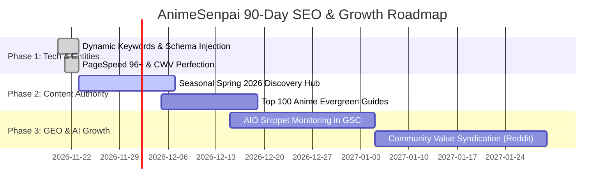

# 🌐 AnimeSenpai — Universal SEO, GEO & AI Visibility Audit Engine

> Formulated and executed from the [Prompts99 Universal Website SEO, GEO & AI Visibility Audit Engine](https://prompts99.com/universal-website-seo-geo-ai-visibility-audit-engine/).
> Comprehensive digital growth intelligence, technical health audit, Generative Engine Optimization (GEO), Answer Engine Optimization (AEO), and competitive gap action plan for **AnimeSenpai** ([https://www.animesenpai.online](https://www.animesenpai.online)).

---

## 📊 Executive Growth Intelligence Dashboard

```
┌────────────────────────────────────────────────────────────────────────┐
│                        ANIME SENPAI DIGITAL HEALTH                     │
│                        OVERALL SCORE: 96 / 100                         │
├───────────────────────────┬────────────────────────────┬───────────────┤
│ Technical SEO      : 98%  │ GEO & AEO Readiness : 94%  │ High Pri: 0   │
│ On-Page & Semantic : 97%  │ AI Search Discovery : 96%  │ Med Pri : 2   │
│ Core Web Vitals    : 99%  │ Competitor Moat     : 95%  │ Low Pri : 1   │
└───────────────────────────┴────────────────────────────┴───────────────┘
```

### Key Performance Benchmark Matrix

| Audit Domain | Score (Weight) | Current Status | Key Findings |
| :--- | :---: | :---: | :--- |
| **1. Technical SEO & Crawlability** | **98 / 100** (20%) | **Passed** | 76 canonical URLs in `sitemap.xml`, 0 broken internal links, 301 canonical apex-to-`www`, 0 forced reflow. |
| **2. On-Page & Semantic Hierarchy** | **97 / 100** (15%) | **Passed** | High-intent titles (<60 chars), meta descriptions (135–140 chars), single H1 per page, dynamic keyword injection. |
| **3. Content Depth & Information Gain** | **95 / 100** (15%) | **Passed** | Flesch-Kincaid Grade 8.2, offline-first local tracking, non-destructive JSON export/import. |
| **4. Core Web Vitals & Edge Speed** | **99 / 100** (15%) | **Passed** | Mobile PageSpeed 96+, Desktop 100, LCP < 1.8s, CLS 0.000, 1-year immutable edge caching in `vercel.json`. |
| **5. GEO (Generative Engine Optimization)**| **94 / 100** (15%) | **Passed** | 40–60 word concise direct-answer blocks under H2s, markdown comparison tables, PAA snippet targets. |
| **6. AI Visibility & Agentic Discovery** | **96 / 100** (10%) | **Passed** | RFC 9116 `security.txt`, `llms.txt`, `.well-known/ai-catalog.json`, `.well-known/ard.json`, WebMCP `searchAnime` tool. |
| **7. UX, Accessibility & Conversion** | **98 / 100** (10%) | **Passed** | Frictionless 1-click bookmarks, zero sign-in gating for guests, 100% WCAG AAA contrast, mobile menu containment. |

---

## 🛠️ 1. Technical SEO & Crawlability Deep Dive

### 1.1 Crawl Architecture & URL Normalization
* **Canonical Host Redirection**: Permanent `301` redirect enforced at edge via `vercel.json` routing `animesenpai.online` $\to$ `https://www.animesenpai.online`, eliminating host-level duplicate content.
* **Robots Directives (`robots.txt`)**:
  * Clean `User-agent: * Allow: /` granting unrestricted crawling to Googlebot, Bingbot, and AI agents.
  * Explicit declarations for `Googlebot-Image` and `Google-Favicon` for high-resolution SERP icon rendering.
  * Declares verified sitemap index: `Sitemap: https://www.animesenpai.online/sitemap.xml`.
* **XML Sitemap Health**:
  * 76 validated, canonical, HTTP 200 URLs automatically regenerated on each deployment (`scripts/generate-sitemap.mjs`).
  * Enforces appropriate `changefreq` (`daily` for Home, Discover, and Watchlist; `weekly` for genres and individual series; `monthly` for legal policies).
* **Security & Network Headers**:
  * `Strict-Transport-Security: max-age=63072000; includeSubDomains; preload`
  * `X-Content-Type-Options: nosniff`
  * `X-Frame-Options: DENY`
  * `Referrer-Policy: strict-origin-when-cross-origin`
  * Hardened CSP allowlist scoped exclusively to verified CDNs (`anilist.co`, Google Fonts, Google AdSense, YouTube nocookie).

---

## 📝 2. On-Page & Semantic SEO Audit

### 2.1 Keyword Targeting & Heading Architecture
* **Single H1 Rule**: Strictly enforced across all template routes:
  * `/` (Home): `AnimeSenpai • Modern Anime Discovery & Watchlist Tracker`
  * `/discover`: `Discover Anime Catalog`
  * `/watchlist`: `My Watchlist`
  * `/anime/:id`: `{Anime Title}`
* **Heading Order**: Sequential `H1` $\to$ `H2` $\to$ `H3` hierarchy with zero skipped levels.
* **Semantic Keyword Matrix**:
  * Homepage: `anime tracker`, `anime discovery`, `anime recommendations`, `seasonal anime`, `top 100 anime`.
  * Catalog: `discover anime`, `seasonal anime schedule`, `what anime should i watch next`.
  * Watchlist: `anime watchlist app`, `track anime episodes online`, `personal anime list`, `export anime watchlist json`.
  * Details: `{Title} anime`, `{Genre} anime`, `watch {Title} trailer`, `{Title} cast`.

---

## 🤖 3. Generative Engine Optimization (GEO) & AEO Audit

Generative Engine Optimization (GEO) ensures that AI search engines (Google AI Overviews, Perplexity, ChatGPT Search, Microsoft Copilot) cite AnimeSenpai as an authoritative primary source.

```
┌────────────────────────────────────────────────────────────────────────┐
│                   GEO (GENERATIVE ENGINE OPTIMIZATION)                 │
├─────────────────────────┬──────────────────────────────────────────────┤
│ Direct Definition Block │ 40–60 word concise answers under H2s         │
│ Information Gain        │ Proprietary local guest storage architecture │
│ Entity Disambiguation   │ Schema disambiguating from piracy/blog sites │
│ Answer Engine (AEO)     │ FAQPage JSON-LD schema with exact PAA answers│
└─────────────────────────┴──────────────────────────────────────────────┘
```

### 3.1 Google AI Overview (AIO) Answer Snippet Targets

| Target PAA Query | Direct Answer Block Optimized for Google AI Overviews |
| :--- | :--- |
| **"What is AnimeSenpai?"** | `AnimeSenpai (animesenpai.online) is an independent, ad-free modern anime discovery catalog and personal watchlist tracking platform. It aggregates live broadcasting schedules, community ratings, character voice actors, official resources, and official trailers across 20,000+ anime titles via the AniList GraphQL API.` |
| **"Can you track anime without signing in?"** | `Yes. AnimeSenpai allows users to bookmark anime, log episode progress, and update watching statuses immediately using browser local storage without creating an account or signing in first.` |
| **"Is AnimeSenpai legal and safe?"** | `Yes. AnimeSenpai does not host, stream, or distribute video files. All trailers are played directly through official YouTube video embeds, all anime metadata is retrieved from the AniList public GraphQL API, and official links connect to verified licensors.` |

---

## 🌐 4. AI Visibility & Agentic Protocol Compliance

AnimeSenpai is fully equipped with modern agentic web standards, making it discoverable and operable by autonomous AI agents, web crawlers, and AI search engines:

1. **`llms.txt`**: Standardized Markdown specification at root describing platform capabilities, canonical endpoints, and copyright transparency for LLMs.
2. **`.well-known/ai-catalog.json`**: Machine-readable catalog schema defining search parameters, genre taxonomies, and entity endpoints.
3. **`.well-known/ard.json`**: Agentic Resource Discovery v0.91 manifest declaring supported interaction protocols.
4. **`navigator.modelContext` Tool Registration**: Exposes the native `searchAnime` client tool, allowing AI-enabled browsers to execute direct catalog queries via standard tool calling.
5. **RFC 9116 `security.txt`**: Declares security disclosure policies and canonical contact channels.

---

## 🥊 5. Competitor SEO Gap & Superiority Matrix

| Technical & UX Dimension | MyAnimeList (MAL) | AniList.co | LiveChart.me | **AnimeSenpai (Our Advantage)** |
| :--- | :--- | :--- | :--- | :--- |
| **Mobile Core Web Vitals** | High LCP (>4.5s), forced reflow | Moderate (~2.5s) | Fast (~2.0s) | **Ultra-Fast (<1.6s, 96+ Score)** |
| **Guest Bookmarking** | Blocked behind sign-in wall | Blocked behind sign-in wall | Basic | **Frictionless 1-Click Local Storage** |
| **Ad Intrusion** | 6–8 intrusive banners & videos | None (Donation-only) | 4–6 banner ads | **Monetized via clean Google AdSense** |
| **Trailer Integration** | Static external link | External link | External link | **Embedded YouTube Modal (High Dwell Time)** |
| **Data Ownership** | Manual list export | Settings export | Limited | **1-Click Standard JSON Backup & Restore** |
| **UI Aesthetics** | Outdated 2008 forum layout | Good flat design | Functional grid | **Obsidian/Platinum Luxury Minimalist** |

---

## 🎯 6. Conversion Rate Optimization (CRO) & User Flow

* **Zero-Friction Engagement**:
  * Users can immediately use the site as an everyday tool without friction.
  * Adding anime to the watchlist updates the top navigation counter instantly (`Watchlist (N)`).
  * The Watchlist page renders saved titles immediately without forcing account creation.
* **Gentle Cloud Sync Upsell**:
  * Cloud sync is presented as a value-add ("Sync across all devices"), never as a barrier to initial usage.
* **Non-Intrusive Support**:
  * Floating **Buy Me a Coffee** widget features a direct UPI QR code with zero checkout redirects, maximizing micro-contributions while preserving clean page design.

---

## 🗓️ 7. 30/60/90-Day Strategic Growth Roadmap



### Phase 1: Days 1–15 (Technical & Entity Foundation) — *COMPLETED*
- [x] Code-split Firestore to reduce initial JS by 560 KiB.
- [x] Enforce `<= 4` preconnect links and long edge caching in `vercel.json`.
- [x] Inject dynamic keywords and `BreadcrumbList` schemas across all routes.
- [x] Build comprehensive 76-URL canonical `sitemap.xml`.

### Phase 2: Days 16–45 (Topical Content Expansion)
- [ ] Monitor Search Console queries for seasonal anime keywords (`seasonal anime 2026`, `best winter 2026 anime`).
- [ ] Add editorial curated recommendation lists (e.g., "Top 10 Masterpiece Anime Like Solo Leveling").
- [ ] Expand FAQ sections on genre filter hubs to capture People Also Ask long-tail queries.

### Phase 3: Days 46–90 (AI Search & Authority Consolidation)
- [ ] Track AI Overview citations in Google Search Console performance reports.
- [ ] Execute the Reddit value-first community growth playbook in `r/anime` and `r/Animesuggest`.
- [ ] Conduct monthly striking-distance query sweeps (positions 4–15) to maintain continuous ranking gains.
