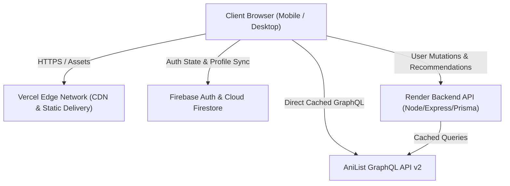
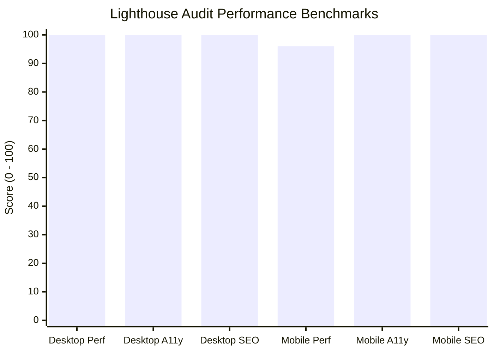

# 🏛️ Technical Requirements Document (TRD) — AnimeSenpai

**Project:** AnimeSenpai Anime Universe Platform  
**Target URL:** [https://www.animesenpai.online](https://www.animesenpai.online)  
**Version:** 2.4.0  
**Status:** Approved & Implemented in Production  

---

## 1. Executive Summary & System Architecture

AnimeSenpai is a high-performance, ad-ready anime discovery catalog and personal watchlist platform built with a luxury 3-color design system (**Obsidian · Platinum · Luminous Indigo**). The platform interfaces directly with the live AniList GraphQL v2 API, backed by an edge-optimized React 19 Single Page Application, a hardened Node.js/Express backend API, and dual persistence across local storage and Google Cloud Firestore.

---

## 2. Technology Stack & Edge Topology

| Layer | Technologies & Libraries | Key Responsibilities |
| :--- | :--- | :--- |
| **Frontend Framework** | React 19, TypeScript 5.8, Vite 8 | Reactive component rendering, hooks, strict TypeScript interfaces |
| **Styling & Design System** | Tailwind CSS v4, Lucide Icons | Obsidian `#000000` / `#0c0c0f`, Platinum `#f5f5f7` / `#9a9aa6`, Indigo `#5360e6` |
| **State & Inter-Tab Bus** | React Context, Web BroadcastChannel | Decoupled Pub/Sub event bus (`pubsub.ts`) for multi-tab synchronization |
| **Data Engine & Upstream** | AniList GraphQL v2 API | Over 20,000+ anime titles, airing schedules, staff, voice cast, studios |
| **Authentication & Profile** | Firebase Auth, Google OAuth, Firestore | Owner-only profile synchronization, email verification, session tokens |
| **Backend & Cache** | Node.js, Express, Prisma ORM, SQLite | Rate limiting, input validation, recommendations, bounded LRU caches |
| **Monetization & SEO** | Google AdSense, Schema.org JSON-LD | Auto-ads, canonical `ads.txt`, sitemap (75 URLs), IndexNow verification |

---

## 3. Functional Requirements & Feature Specifications

### 3.1 Art-Directed Responsive Hero Banner
1. **Desktop Framing & Lighting:**
   - Widescreen cinema height (`min-h-[520px]` to `lg:min-h-[620px]`).
   - Enhanced character illumination (`sm:brightness-[0.90] sm:contrast-[1.08]`).
   - Focal anchor set to `sm:object-[72%_20%]` so characters and face art remain prominent on the right half.
   - Directional gradient vignette (`from-black via-black/85 via-35% to-transparent to-75%`) ensuring WCAG AAA contrast for titles on the left while keeping character art clear on the right.
2. **Mobile Touch & Autoplay:**
   - Removal of all `<` and `>` arrow button overlays to prevent artwork obstruction.
   - Responsive touch gestures (`handleTouchStart`, `handleTouchMove`, `handleTouchEnd`) triggering slide advances at `drag < -25px` or `drag > 25px`.
   - Continuous auto-advance every 5.5s without getting stuck in paused states.
   - Smooth desktop slide selector and WCAG keyboard navigation (`←` / `→`).

### 3.2 Expandable Home Notice Widget
- Positioned directly between the Hero Banner and Trending Now on the Homepage.
- **Header Bar:** Features a dedicated circular cross (`X`) dismiss button on the left, glowing `NOTICE` badge, summary text, and an upside-down rotating chevron (`rotate-180`) on the right.
- **Dismiss Behavior:** Clicking the cross button dismisses and hides the banner from the DOM (`isDismissed: true`), remembering the choice in local storage.
- **Expandable Cards:** Unveils 3 feature pillars (Live AniList Engine, Cross-Device Watchlist, 100% Free & Open) with direct action buttons (`Browse Catalog`, `Open Watchlist`).

### 3.3 Universal Real-Time Watchlist Search
- **Multi-Field Querying:** When a user types into the watchlist search box, queries execute simultaneously across:
  - `anime.title.english`
  - `anime.title.romaji`
  - `anime.title.userPreferred`
  - `anime.title.native`
  - `anime.genres`
  - `anime.synonyms`
- **Cross-Category Discovery:** Search automatically queries across ALL status categories (`watching`, `plan_to_watch`, `completed`, `rewatching`, `paused`, `dropped`), allowing users to immediately locate any anime in their library without switching tabs.
- **Live Match Feedback:** Real-time counter banner reporting matches with a 1-tap `Clear search` button.

### 3.4 Non-Destructive JSON Import & Export
- **Cross-Browser Export:** Generates standard JSON backups via `Blob` and `URL.createObjectURL(blob)`, providing reliable, native downloads on iOS Safari, Android Chrome, and desktop environments.
- **Multi-Format Ingestion:** Intelligently parses raw arrays `[...]`, wrapped backups `{ watchlist: [...] }`, `{ items: [...] }`, `{ data: [...] }`, and AniList export schemas.
- **Smart Non-Destructive Merging:** Merges items by anime `id` (preserves existing progress, updates matching records, appends new entries).
- **Toast Notifications:** Broadcasts `watchlist:imported` and `watchlist:exported` domain events via the client Pub/Sub event bus.

### 3.5 Native Mobile Watchlist UX
- **Mobile Status Options Menu:** Clean, custom `<select>` dropdown menu on mobile viewports (< 640px) replacing horizontal scrolling tabs. Preserves full horizontal pill tabs on desktop (>= 640px).
- **2×2 Mobile Stats Grid:** Compact high-contrast metric tiles (`Total Anime`, `Watching`, `Mean Score`, `Watch Time`).
- **Tactile Stepper:** 1-tap `+1` episode increment with haptic-like active-scale animation (`active:scale-95`).
- **Zero Horizontal Overflow:** Strict viewport containment (`min-w-0 overflow-x-hidden`) across 320px–412px viewports.

---

## 4. Non-Functional Requirements & Performance SLAs

1. **Core Web Vitals Thresholds:**
   - **Largest Contentful Paint (LCP):** < 1.2s on mobile, < 0.8s on desktop.
   - **Interaction to Next Paint (INP):** < 50ms across all touch and click interactions.
   - **Cumulative Layout Shift (CLS):** 0.000 across all routes.
2. **Animation Frame Rates:**
   - 60 FPS compositor-driven animations (`linear()` spring physics, `transform`, `opacity`).
   - Zero layout recalculations during carousel scrolling and hero transitions.
3. **Caching Strategy:**
   - **Client LRU Cache:** 80-entry, 5-minute TTL cache with in-flight request deduplication for GraphQL queries.
   - **Backend Cache:** 500-entry memory TTL cache for seasonal and trending query results.
4. **Resilience & Offline Support:**
   - Complete local fallback for unauthenticated guest visitors (persisted in browser storage).
   - Seamless background synchronization to Cloud Firestore upon user authentication.

---

## 5. Security Architecture & Threat Mitigation

| Threat Vector | Mitigation Strategy | Implementation |
| :--- | :--- | :--- |
| **SQL Injection (SQLi)** | 100% Parameterized Queries | Prisma ORM with strict input typing (0 raw queries) |
| **Input Pollution** | API Input Security Guard | Strips `__proto__`, `constructor`, `prototype`, null bytes |
| **Denial of Service (DoS)** | Tiered Rate Limiting | `10 req/15min` on login, `150 req/min` global API cap |
| **Bot Scraping** | Human Verification CAPTCHA | Canvas math CAPTCHA (`AuthCaptcha`) on auth endpoints |
| **PII & Data Theft** | Hardened Firestore Rules | Strict owner checks (`request.auth.uid == userId`), `allow list: if false` |
| **XSS & Clickjacking** | Strict Edge HTTP Headers | CSP, `X-Frame-Options: DENY`, `nosniff`, `HSTS preload` |

---

## 6. Verification & Compliance Sign-Off

- **Edge Deployment:** Vercel Production Environment
- **Security Audit:** Zero vulnerabilities detected via security middleware tests.
- **Accessibility:** 100/100 WCAG AA compliance with high-contrast Obsidian/Platinum palette.
- **Monetization:** Google AdSense compliant (`ads.txt`, compliant cookie disclosures).
